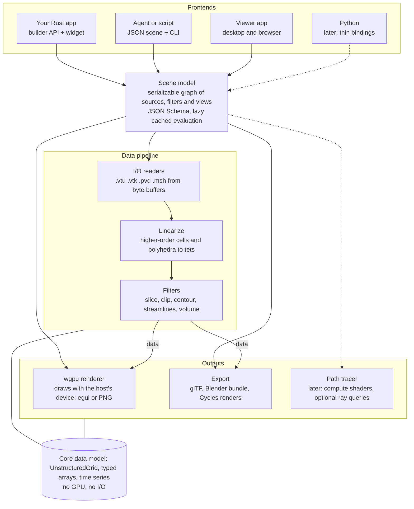

# Tetraglass: Design Plan for a Rust-Native Scientific Visualization Library

As of 2026-10-22. Exported from the planning document; binding decisions are summarized in `decisions.md`, tasks in `roadmap.md`.

## Vision and goals

Tetraglass is a Rust-native toolkit for visualizing FEM/CFD results on unstructured meshes. It is built on wgpu, embeds in Rust apps first, and can be driven by coding agents through a declarative scene file. VTK-class breadth is the long-term horizon; the first year targets a narrow, polished core.

**Target users**

- Rust developers building simulation or engineering tools who need a mesh-results viewport inside their own egui app.
- Engineers and researchers who want a quick look at .vtu or .msh results without installing ParaView.
- Coding agents that write a scene file, render it headlessly to PNG, look at the image and iterate.

**Success criteria for the first year (through M3)**

- Load a .vtu, .pvd or .msh file with mixed linear, higher-order and polyhedral cells, and color it by any point or cell field.
- Slice, clip and contour that mesh interactively on a mid-range GPU (performance target to be set during milestone 1).
- Embed the viewport in an existing egui app with a few dozen lines of code.
- Go from scene file to PNG with one CLI command and no compile step.
- Open the same scene in the desktop viewer and in the browser.

**Non-goals for now**

- Out-of-core, distributed or MPI rendering: data is assumed to fit in GPU memory.
- 2D plotting and charts: existing crates such as egui_plot cover this.
- Image and medical volume pipelines: structured grids come later, if at all.
- A full Python API in the first release.
- A built-in ray tracer before the rasterizer and export path are solid.

## Decisions so far

Every later section follows from these answers; changing one of them is the main way to change the plan.

| Topic | Decision | What it forces |
| --- | --- | --- |
| Data | Unstructured meshes (FEM/CFD) | A VTK-style unstructured grid is the core data type |
| Scale | Fits in GPU memory | No streaming, out-of-core or MPI layer |
| Workflow priority | 1 embed in Rust apps, 2 interactive, 3 publication, 4 headless batch | The API is the product; the viewer is one host among many |
| First host app | egui | Ship an egui viewport widget in the first milestone |
| Agent interface | Declarative JSON scene + CLI | Scene model must be pure, serializable data |
| Ray tracing | Blender first (export and automated renders), built-in later | Blender export and headless Cycles renders precede any path tracer |
| Platforms | Desktop + web browser | No C dependencies in the core; loaders read byte buffers |
| Formats | VTK (.vtu/.vtk/.pvd), Gmsh .msh | Pure-Rust parsers; no HDF5 needed |
| Mesh features | Time series, higher-order cells, polyhedra | Native storage, plus a linearization step for filters |
| Early filters | Slice, clip, contour, streamlines, glyphs, volume rendering | Six algorithm families; staged over several milestones |
| Team | Solo, evenings and weekends | Ruthless scope; reuse crates; one milestone at a time |
| Goal | Open-source community library | Stable public API, docs and tests matter from the start |

## Architecture

Dependencies run one way: frontends build a scene, the scene drives the data pipeline, and outputs consume its datasets. Nothing below the frontends knows about windows, egui or files on disk.



Arrows run from caller to callee; dashed parts come later. The core data model is shared by every layer and depends on neither the GPU nor I/O.

| Crate | Role | Depends on |
| --- | --- | --- |
| `core` | Data model, cell types, arrays, time series | glam, serde |
| `io` | VTK and Gmsh readers, .vtu writer | core |
| `filters` | Linearize, surface extraction, tet kernel, streamlines, glyph placement, resampling | core |
| `scene` | Scene structs, JSON Schema, lazy cached evaluation | core, io, filters |
| `render` | wgpu renderer, colormaps, annotations, picking, offscreen targets | core, scene |
| `egui` | Viewport widget, camera controls, generated property panels | render |
| `export` | glTF and Blender bundle writers | scene, filters |
| `cli` | inspect, render, validate, schema, view, export | all of the above |
| `viewer` | eframe app for desktop and web | egui |

Crates are named `tetraglass-core`, `tetraglass-io` and so on; an umbrella crate, `tetraglass`, re-exports them behind feature flags.

**Build or reuse.** Reuse focused crates (glam, serde, schemars, egui, and vtkio and mshio if they pass the M0 tests). Build the filters, scene model and renderer in-house: they are the library's core and its reason to exist.

## Data model

One type, `UnstructuredGrid`, carries every mesh. Higher-order cells and polyhedra are stored natively and never converted on load.

- **Points:** `Vec<[f64; 3]>` on the CPU. The GPU receives f32 positions relative to the dataset center, which avoids precision loss on large-coordinate CFD domains.
- **Cells:** a cell-type array, an offsets array and a flat connectivity array. This mirrors VTK's layout, so .vtu files load with little conversion.
- **Cell types:** linear (vertex, line, triangle, quad, tet, hex, wedge, pyramid), higher-order Lagrange cells with an order field, and polyhedra as face streams. Node ordering follows VTK; the Gmsh reader permutes into it.
- **Attributes:** named point and cell arrays, typed (f32, f64, i32, i64, u8), with 1, 3, 6 or 9 components. Storage sits behind `Arc` for cheap copy-on-write sharing between filters.
- **Time series:** a list of (time, lazy loader) entries. Only the current step and a small cache stay resident, so a series larger than memory still works.
- **Field metadata:** value range per array and component, computed once and cached. The `inspect` command and colormap defaults both read it.

**Linearization layer.** Filters and the renderer never handle higher-order or polyhedral cells directly. A `linearize` step builds a linear-tetrahedron view on demand:

- Higher-order cells are subdivided in reference space to a configurable level; positions and fields come from the Lagrange basis.
- Polyhedra get a centroid point; each face is fan-triangulated and joined to it, giving tets.
- Linear cells use the standard tet decomposition with face-consistent diagonals.
- The view keeps a map back to source cell ids, so picking and cell data still refer to the original mesh.

The payoff for a solo developer: every filter needs exactly one implementation, on tets. Per-cell-type fast paths can come later without changing the API. Element edges in wireframe mode are drawn from the original cells, so users see their real mesh, not the sub-cells.

## Scene model and agent interface

The scene is plain data: Rust structs with serde, describing sources, filters, representations, camera and output. Every frontend produces the same scene, so the Rust API, JSON files, the viewer's save format, the web viewer and the Blender exporter all share one model.

**Scene structure.** A scene is a small directed graph. Sources read files; filters take named inputs; representations turn a dataset into something visible; views hold representations, a camera and lights. Pipeline evaluation is lazy and cached by input hash, so changing a colormap never re-runs a contour.

A scene file an agent might write:

```json
{
  "version": 1,
  "sources": { "flow": { "file": "results.pvd" } },
  "filters": {
    "cut":  { "type": "slice", "input": "flow", "normal": [0, 0, 1] },
    "iso":  { "type": "contour", "input": "flow", "field": "pressure", "values": [101325] }
  },
  "view": {
    "show": [
      { "input": "cut", "color_by": "velocity:magnitude", "colormap": "viridis", "colorbar": true },
      { "input": "iso", "opacity": 0.4 }
    ],
    "camera": { "fit": "all", "azimuth": 30, "elevation": 20 }
  },
  "output": { "image": "out.png", "size": [1600, 900], "time": "last" }
}
```

**CLI for agents and humans.** One binary, every command scriptable, every output optionally JSON:

| Command | What it does |
| --- | --- |
| `inspect <file>` | Lists arrays, components, value ranges, cell types, bounds and time steps |
| `render <scene> -o out.png` | Renders headlessly with the built-in rasterizer: no window, no compile step |
| `render <scene> --engine cycles` | Hands the same scene to a headless Blender and returns the Cycles image |
| `validate <scene>` | Checks the scene against the schema and the data, with suggestions |
| `schema` | Prints the JSON Schema, generated from the Rust types with schemars |
| `view <scene>` | Opens the viewer and hot-reloads when the file changes |
| `export <scene> --gltf` | Writes glTF or the Blender bundle without rendering |

**Agent-friendly details that matter:**

- Errors carry a JSON path and a fix: `view.show[0].color_by: no array "presure"; did you mean "pressure"?`.
- `render` prints a short JSON summary (arrays used, value ranges, camera) beside the PNG, so the agent can check its work without reading pixels.
- `view` with hot reload lets a human watch the agent iterate in real time.
- The repository ships agent instructions with the schema, worked scenes and common mistakes (`AGENTS.md` and the `author-scene` skill).
- Rendering is deterministic for a fixed GPU and driver, which also enables image regression tests.

**Rust builder API.** The typed, primary interface; it builds the same scene structs:

```rust
let flow = scene.source(Source::file("results.pvd"));
let cut = scene.filter(Slice::new(flow).normal(Vec3::Z));
scene.show(cut).color_by("velocity").magnitude().colormap(Colormap::Viridis);
```

**Escape hatches and later frontends.** Logic that JSON cannot express (custom derived fields, loops over parameters) goes in plain Rust, using a pre-compiled template crate so only one small file recompiles. Python bindings through PyO3 become a thin layer later, because they only need to build scene data. A small MCP server wrapping `inspect` and `render` is another cheap later option.

## Rendering

The renderer takes the host's wgpu `Device` and `Queue` and draws into textures it is given. It never creates a window or runs an event loop, which is what makes embedding the first-class use case.

**Embedding in egui.** egui-wgpu lets an app do custom wgpu rendering through a paint callback with `prepare` and `paint` steps ([egui_wgpu docs](https://docs.rs/egui-wgpu/latest/egui_wgpu/trait.CallbackTrait.html)). The widget uses `prepare` to render into its own offscreen color and depth targets, then shows the result as an image. Owning the passes keeps depth, MSAA and multi-pass transparency independent of egui's render pass. The same offscreen path produces PNGs for the CLI.

**Version coupling.** The library must use the same wgpu major version as egui-wgpu. Releases follow egui's release cadence, and all wgpu calls stay inside the render crate so upgrades touch one place.

**Representations:**

- Surface (external faces of the volume mesh), surface with element edges, wireframe and points.
- Lines and tubes for streamlines; instanced glyphs (arrows, cones, spheres).
- Volume rendering, added with the volume filter.

**Coloring.** Scalars upload once as an f32 vertex attribute; the colormap is a 256-entry 1D texture. Switching colormap, range or log scale changes only a uniform, with no re-upload. Cell data renders flat through a per-triangle cell index into a storage buffer. Defaults are perceptually uniform: viridis and cividis for sequential data, cool-warm for diverging data.

**Interactive clipping.** Dragging a clip plane uses a shader clip plane for instant feedback. Releasing it runs the exact clip filter on a worker thread, and the result swaps in when ready.

**Transparency and lighting.** Weighted blended order-independent transparency is cheap and works on every backend; depth peeling is a later option for exact results. Lighting starts with a headlight plus key and fill lights. Screen-space ambient occlusion comes later and gives much of the depth cue that ray tracing would.

**Picking and annotations.** A GPU ID buffer returns representation and cell ids under the cursor, enabling value probes. Colorbars, axes triad and text labels are drawn by the renderer itself, not by egui, so headless PNGs contain them too.

## Filters

One marching-tetrahedra kernel on the linearized view powers slice, clip and contour. That turns six requested filter families into four algorithms, which is the main scope saving in this plan.

| Filter | Algorithm | Output | Milestone |
| --- | --- | --- | --- |
| External surface | Face hashing; keep faces with one owner cell | Surface for display | M0 |
| Threshold | Keep cells whose value is in range | Unstructured grid | M2 |
| Slice | Tet kernel on signed distance to a plane | Surface | M2 |
| Contour | Tet kernel on a scalar; several isovalues; all arrays interpolated | Surface | M2 |
| Clip | Tet kernel keeping one side; "crinkle" mode keeps whole original cells | Unstructured grid | M2 |
| Streamlines | Seeds on point, line or plane; BVH cell locator; RK4, then adaptive RK45 | Polylines with arrays | M4 |
| Glyphs | Arrows, cones or spheres at points or seeds, oriented and scaled by a vector | GPU instances | M4 |
| Volume rendering | Resample onto a regular grid, then GPU ray marching with a transfer function | 3D texture | M4 |

**Execution.** Filters run on the CPU in Rust, parallel through rayon on native targets. They run off the UI thread; the viewport keeps showing the previous result until the new one is ready. GPU compute versions are an optimization for later, mainly for interactive contouring of large meshes.

**Volume rendering choice.** Resampling to a regular grid is approximate but simple, fast and portable. Exact methods for unstructured grids (projected tetrahedra, ray casting through cell adjacency) can replace it later behind the same representation.

**Correctness.** Each filter gets analytic test cases (a sphere's distance field must contour to a sphere) and comparisons against VTK reference outputs for a few datasets.

## I/O and export

All readers take a byte slice or a `Read + Seek` source; path-based helpers exist only on native. This one rule makes the same readers work in the browser.

| Format | Plan | Why |
| --- | --- | --- |
| VTK XML (.vtu) and legacy (.vtk) | Evaluate [vtkio](https://docs.rs/crate/vtkio/0.7.0-rc2) in M0; write a focused reader if it falls short | vtkio covers legacy and XML, serial and parallel, but is still at a 0.7 release candidate; higher-order and polyhedron support must be checked |
| ParaView collection (.pvd) | Own small parser | A short XML list of files and time values; it drives time series |
| Gmsh (.msh) | Own reader, or extend [mshio](https://docs.rs/mshio) upstream | mshio parses MSH 4.1 only, and only the Entities, Nodes and Elements sections; results in $NodeData and $ElementData are skipped, and MSH 2.2 is unsupported |
| .vtu writer | Own | Saves filter output and enables round-trip tests |

Gmsh and VTK number higher-order nodes differently, so the Gmsh reader carries per-element permutation tables into VTK ordering. Each table gets a test mesh generated by Gmsh itself.

**Export for Blender.** Two stages, both fed by the scene model:

1. **glTF (.glb):** triangulated surfaces with baked vertex colors. The normalized scalar also goes into a second texture coordinate, so a Blender user can re-color through a color ramp node. Time series export as one .glb per step plus a small manifest.
2. **Blender add-on and bundle:** a bundle holds a JSON manifest and raw binary buffers per time step. A pure-Python add-on with numpy rebuilds meshes with their attributes, the matching camera, lights, a colormap shader node and one frame per time step. No compiled dependencies, so it installs like any add-on, and the same import code runs headless for automated renders.

## Viewer and web target

The viewer is a thin eframe app built from the same egui widget that users embed, so the viewer doubles as the widget's integration test. egui stays the GUI choice: it runs on desktop and in the browser from one codebase, and it is what the first host app uses.

**Viewer layout.** A docking layout (egui_tiles or egui_dock) with a pipeline tree, a property panel, one or more viewports, a time slider and a colorbar editor. The property panel is generated from the scene structs, so every new filter option appears in the GUI without hand-written UI code.

**Web: WebGPU only, no WebGL2 fallback.** WebGL2 lacks compute shaders and storage buffers, and a second backend would double testing for one developer. As of November 2025, WebGPU ships in Chrome and Edge 113+, Firefox 141+ on Windows and 145+ on Apple-silicon macOS, and Safari 26; Firefox on Linux and Intel Macs was still in progress ([web.dev](https://web.dev/blog/webgpu-supported-major-browsers)). Browsers without WebGPU get a clear message instead of a broken page.

**Web constraints to design around from day one:**

- **Files:** data arrives by drag-and-drop or URL fetch, as byte buffers.
- **Threads:** WASM threads need cross-origin isolation, so filters start single-threaded on the web and move to a Web Worker later.
- **Memory:** wasm32 has a 4 GiB address space, which caps mesh size in the browser; large data stays a native use case.
- **Sharing:** a link to a scene file plus its data opens directly in the web viewer, which is a strong hook for community adoption.

## Ray tracing path

Ray tracing arrives in three steps, each reusing what the previous one built. The scene model and GPU buffers stay the same throughout.

1. **Blender, exported and steered (M3).** The library writes a bundle and can launch Blender itself to render it with Cycles. Publication stills and animations come early, with no renderer work.
2. **Built-in progressive path tracer (M5).** A compute-shader path tracer with its own BVH over the rendered triangles. It runs on every wgpu backend, including WebGPU in the browser, and accumulates samples in the viewport whenever the camera stops moving.
3. **Optional hardware acceleration.** wgpu exposes ray queries behind `Features::EXPERIMENTAL_RAY_QUERY`, marked as subject to breaking changes; ray tracing pipelines are still in development ([wgpu docs](https://wgpu.rs/doc/wgpu/documentation/extensions/ray_tracing/index.html)). Ray queries would replace the software BVH traversal on native GPUs that support them, behind a feature flag, once the API settles. WebGPU has no ray tracing, so the software path remains the browser default.

**Steering Blender directly.** Blender runs headless from the command line with a Python script (`blender --background --python script.py -- <args>`); Blender's own [background job template](https://projects.blender.org/archive/blender-archive/src/commit/24b47c00eaabe12b5262b59a185da154a477bd98/release/scripts/templates_py/background_job.py) shows the pattern. So `render <scene> --engine cycles` works like this:

1. The CLI evaluates the scene and writes the bundle to a temporary folder.
2. It launches the user's Blender in background mode with the importer script, passing samples, resolution, device and output path after `--`.
3. The script builds the Blender scene, sets Cycles options (CPU or a GPU backend such as OptiX, CUDA, HIP or Metal), renders, and writes PNGs or frames.
4. The CLI streams Blender's progress, waits for it to exit, and returns the image path plus the same JSON summary as the rasterizer.

For an agent the loop stays the same: iterate with the fast rasterizer, then flip one flag for the final ray-traced image. Camera, colormap and lights come from the same scene, so the Cycles image matches the preview. Each run can also save a .blend file, so a person can open the exact scene in Blender and polish it by hand.

| Mode | How it works | When |
| --- | --- | --- |
| One-shot batch | A new Blender process per render: files in, image out | M3; simplest and most robust |
| Persistent worker | Blender stays running with a small socket server in the script and receives new scenes without restarting | Later, if startup time slows iteration |
| Live link | The viewer pushes camera and scene changes into an open Blender session | Later, for users who finish work in Blender's UI |

**Licensing boundary.** Blender's FAQ allows independently licensed software that runs outside Blender, produces data for it and executes Blender to operate on that data; published scripts that call Blender's Python API must be GPL ([Blender FAQ](https://www.blender.org/support/faq/)). So the Rust crates stay MIT OR Apache-2.0, while the importer script and add-on live in a separate, GPL-licensed folder or package. The library never bundles Blender; it uses an installed copy found through a config setting or `PATH`.

The bundle format from the Blender exporter is renderer-neutral, so other offline renderers can be added later with a small exporter each.

## Roadmap

Release 0.1 lands after the core filters in M2, about nine months after a November 2026 start. Dates assume roughly 8 to 10 hours a week and will slip; the order is the part to keep. Detailed tasks are in `roadmap.md`.

| Milestone | Estimated dates | Scope | Gate |
| --- | --- | --- | --- |
| M0 Foundations | Nov–Dec 2026 | Data model, .vtu reader, outer surface; egui viewport widget, offscreen PNG | A .vtu renders colored by a field, in egui and to PNG |
| M1 Agent loop | Jan–Mar 2027 | JSON scene + schema, CLI, live viewer; Gmsh reader, .pvd time series, colorbars | An agent goes from file to PNG with no compile step |
| M2 Core filters | Apr–Jul 2027 | Linearize higher-order cells and polyhedra; slice, clip, contour, threshold; picking | **Release 0.1** on crates.io with docs and a gallery |
| M3 Web and export | Aug–Oct 2027 | WASM viewer on WebGPU, shareable links; glTF, Blender add-on, transparency | One CFD result shown in Cycles and in the browser |
| M4 Flow and volume | Nov 2027–Feb 2028 | Streamlines, glyphs, volume rendering; animation export, performance pass | **Release 0.2** with a stable scene schema |
| M5 Path tracer | from Mar 2028 | Compute-shader path tracer in the viewer; Python bindings if users ask | Open-ended, driven by community demand |

Each gate is a demo you can show, not a feature count. The agent loop comes before the filters on purpose: from M1 on, a coding agent can write test scenes and gallery entries for every later milestone.

## Open-source setup

Set up the community scaffolding in M0, while it is cheap; retrofitting tests and docs onto a grown codebase costs far more evenings.

- **License:** MIT OR Apache-2.0, the Rust ecosystem default. Any code ported from VTK keeps VTK's BSD-3 notice in the files it came from.
- **Name:** Tetraglass, hosted at github.com/Tetraglass/tetraglass. All planned crate names were free on 2026-10-22; reserve them on crates.io before the first public commit.
- **Tests:** unit tests per filter, VTK reference outputs for a few public datasets, and image regression tests with a tolerance. CI renders on a software Vulkan driver (Mesa lavapipe), so render tests need no GPU.
- **CI:** fmt, clippy, tests, a WASM build of the viewer, and a render of every gallery scene on each pull request.
- **Docs:** API docs on docs.rs plus an mdBook guide. Its gallery is a folder of scene files rendered in CI, so every gallery image is also a test and an agent example.
- **Versioning:** 0.x semver until the scene schema stabilizes; the schema carries its own version field and a migration path from day one.
- **Contributors:** an architecture page, an "add a filter" walkthrough and labeled good-first issues. New filters and readers are the natural contribution units.

## Risks and open questions

The biggest risk is scope against evenings-and-weekends time; every other risk is manageable with tests and pinning.

| Risk | Impact | Mitigation |
| --- | --- | --- |
| Scope creep | Nothing ships | Milestone gates; non-goals stay non-goals until 0.2 |
| wgpu and egui breaking releases | Upgrade work every few months | All wgpu calls in one crate; upgrade in lockstep with egui |
| Higher-order node orderings | Silently wrong geometry | A Gmsh- and VTK-generated test mesh per cell type and order |
| Interactive filter speed on large meshes | Laggy slicing | Shader clip planes while dragging, worker threads, GPU compute later |
| Browser memory (4 GiB wasm32) | Large meshes fail on the web | Document the limit; native viewer for big data |
| Image tests differ across GPUs | Flaky CI | Tolerance-based comparison on a software renderer |
| Blender Python API changes | Automated renders break on a new Blender release | Declare a supported version range; render one test scene per supported release in CI |

**Open questions:**

- [x] Project name and crate namespace: Tetraglass, with crates named `tetraglass-*` and the repository at github.com/Tetraglass/tetraglass.
- [x] Reuse vtkio and mshio, or write focused readers? Write focused in-house readers in `tetraglass-io` (D-018).
- [ ] Which public FEM/CFD datasets become the reference test set, and under what licenses?
- [ ] Which Blender versions to support, and do the GPL-licensed Blender scripts live in a separate folder or their own repository?
- [ ] When to add Python bindings: on demand, after 0.2.

## Sources

All pages opened on 2026-10-22.

- [vtkio 0.7.0-rc2 on docs.rs](https://docs.rs/crate/vtkio/0.7.0-rc2)
- [mshio 0.4.2 on docs.rs](https://docs.rs/mshio)
- [egui_wgpu CallbackTrait](https://docs.rs/egui-wgpu/latest/egui_wgpu/trait.CallbackTrait.html)
- [wgpu ray tracing extensions](https://wgpu.rs/doc/wgpu/documentation/extensions/ray_tracing/index.html)
- [WebGPU is now supported in major browsers (web.dev, Nov 2025)](https://web.dev/blog/webgpu-supported-major-browsers)
- [Blender FAQ: add-ons, scripts and the GPL](https://www.blender.org/support/faq/)
- [Blender background job template](https://projects.blender.org/archive/blender-archive/src/commit/24b47c00eaabe12b5262b59a185da154a477bd98/release/scripts/templates_py/background_job.py)
