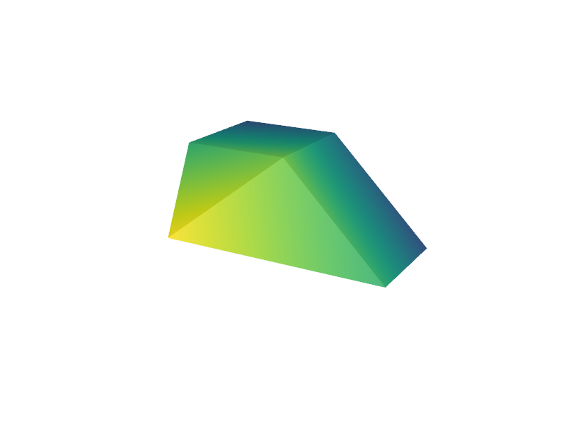
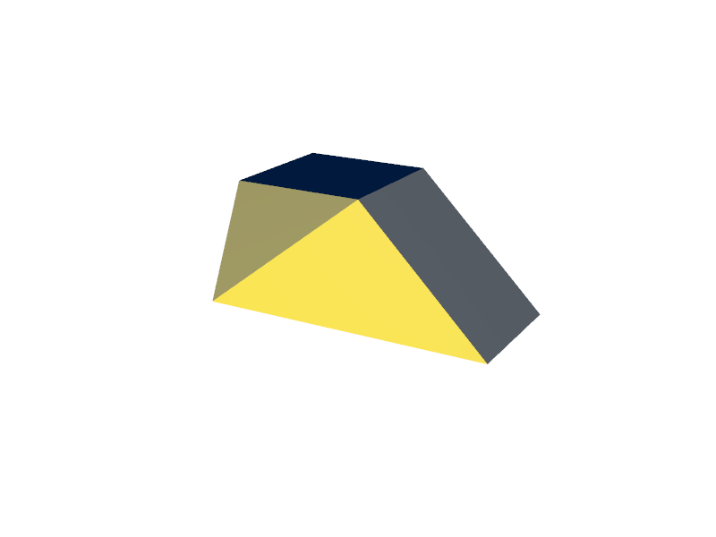
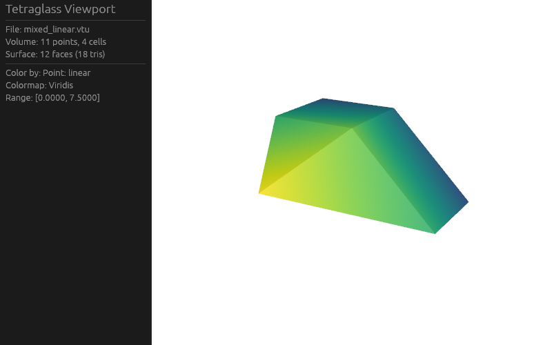

# Milestone M0 Gate — Foundations

- **Date:** 2026-10-23
- **Gate criteria (`docs/roadmap.md`):** *"a `.vtu` file renders colored by a field, both inside an egui app and to a PNG."*
- **Status:** Passed (locally and in GitHub Actions CI on Mesa `lavapipe`).

---

## 1. Checklist Verification

- All M0 tasks (`M0.1` through `M0.9`) are ticked in `docs/roadmap.md`.
- Full verification suite (`cargo xtask verify`: `rustfmt`, `clippy --all-targets -- -D warnings`, workspace unit/integration/doc tests, `wasm32-unknown-unknown` build of `tetraglass-core`/`tetraglass-io`/`tetraglass-filters`/`tetraglass-scene`, single `wgpu v30.0.1` check, and `cargo-deny` check) passes cleanly.
- Headless rendering regression tests pass against the committed Mesa `lavapipe` baselines (`tests/baselines/mixed_linear_linear.png` and `tests/baselines/mixed_linear_cell_id.png`).

---

## 2. Gate Demonstration

### 2.1 Headless `.vtu` to PNG Rendering (`tetraglass-render`)

Command:

```sh
cargo test -p tetraglass-render --test render_mixed_linear
```

Output:

```text
running 2 tests
test render_validates_errors_and_diff_highlighting ... ok
test render_mixed_linear_colored_by_linear_and_cell_id ... ok

test result: ok. 2 passed; 0 failed; 0 ignored; 0 measured; 0 filtered out
```

Rendered outputs (`testdata/vtk/mixed_linear.vtu`, 800×600, 4× MSAA):

1. **Point field `linear` (`Viridis` colormap):**
   

2. **Cell field `cell_id` (`Cividis` colormap):**
   

---

### 2.2 Interactive & Offscreen `egui` Viewport (`tetraglass-egui`)

Interactive desktop example command:

```sh
cargo run -p tetraglass-egui --example egui_viewport -- testdata/vtk/mixed_linear.vtu --frames 3
```

Offscreen `egui` + `ViewportWidget` integration test command:

```sh
cargo test -p tetraglass-egui --test viewport_offscreen
```

Output:

```text
running 2 tests
test available_field_options_lists_solid_point_and_cell_arrays ... ok
test viewport_widget_resizes_and_runs_prepare_callback_in_egui_wgpu ... ok

test result: ok. 2 passed; 0 failed; 0 ignored; 0 measured; 0 filtered out
```

Composited `egui` control panel + 3D `ViewportWidget` rendering `testdata/vtk/mixed_linear.vtu` colored by `Point: linear` (`Viridis`):


