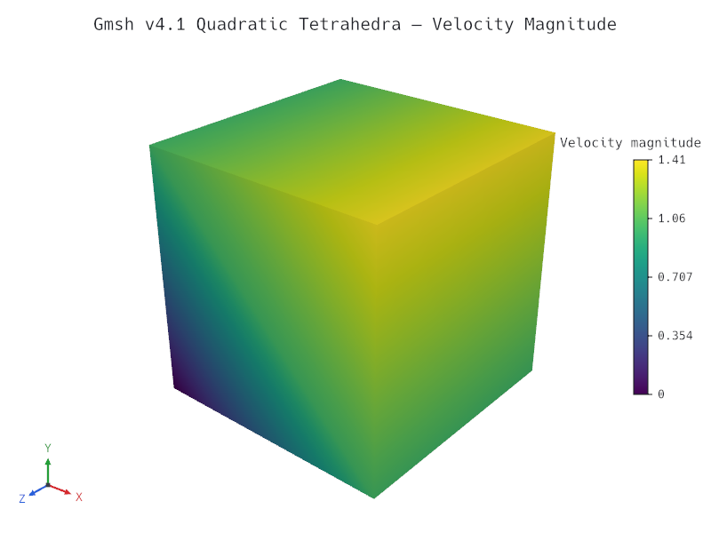
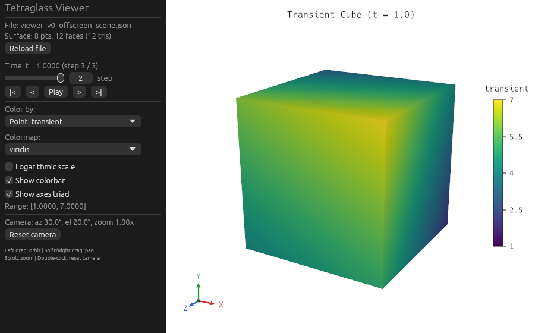

# Milestone M1 Gate — Agent Loop

- **Date:** 2026-10-24
- **Gate criteria (`docs/roadmap.md`):** *"a fresh agent session, given only the CLI and `docs/scene-format.md`, goes from a test file to a correct PNG with no compile step."*
- **Status:** Passed.

---

## 1. Checklist Verification

- All M1 tasks (`M1.1` through `M1.10`) are ticked in `docs/roadmap.md`.
- Full verification suite (`cargo xtask verify`: `rustfmt`, `clippy --all-targets -- -D warnings`, workspace unit/integration/doc tests across `tetraglass-core`, `tetraglass-io`, `tetraglass-filters`, `tetraglass-scene`, `tetraglass-render`, `tetraglass-egui`, `tetraglass-viewer`, and `tetraglass-cli`, `wasm32-unknown-unknown` build of the four web-compatible crates, single `wgpu v30.0.1` check, and `cargo-deny` check) passes cleanly.
- All five gallery scenes (`gallery/*.json`) validate, render, and match their committed visual regression baselines (`tests/baselines/*.png`) within the `/render-check` pixel threshold (`mean_abs_diff <= 0.01`, `pct_over_4 <= 0.5%`), and the `author-scene` skill snippet validates and renders cleanly via `cargo test -p tetraglass-cli --test cli`.

---

## 2. Gate Demonstration

### 2.1 Fresh-Agent Zero-Compile Loop (`tetraglass inspect` → `validate` → `render`)

A fresh subagent session (`f0f0dd8e-2043-4581-bfb0-78c9373b3090`) was launched with access restricted strictly to the pre-built `target/debug/tetraglass` CLI binary and `docs/scene-format.md` (no `cargo` commands, no Rust source files, no existing gallery files).

#### Step 1: Dataset Inspection (`tetraglass inspect`)

Command:

```sh
target/debug/tetraglass inspect testdata/gmsh/tet2_v41.msh --json
```

Output:

```json
{
  "file": "testdata/gmsh/tet2_v41.msh",
  "format": "msh",
  "num_points": 27,
  "num_cells": 6,
  "bounds": {
    "min": [0.0, 0.0, 0.0],
    "max": [1.0, 1.0, 1.0]
  },
  "cell_types": {
    "quadratic_tetra": 6
  },
  "point_arrays": [
    {
      "name": "linear",
      "scalar_type": "f64",
      "components": 1,
      "num_tuples": 27,
      "component_ranges": [[0.0, 6.0]]
    },
    {
      "name": "radius",
      "scalar_type": "f64",
      "components": 1,
      "num_tuples": 27,
      "component_ranges": [[0.0, 0.8660254037844386]]
    },
    {
      "name": "velocity",
      "scalar_type": "f64",
      "components": 3,
      "num_tuples": 27,
      "component_ranges": [[-1.0, -0.0], [0.0, 1.0], [0.0, 0.0]],
      "magnitude_range": [0.0, 1.4142135623730951]
    }
  ],
  "cell_arrays": [
    {
      "name": "cell_id",
      "scalar_type": "f64",
      "components": 1,
      "num_tuples": 6,
      "component_ranges": [[0.0, 5.0]]
    }
  ],
  "time_steps": []
}
```

#### Step 2: Scene Authoring & Validation (`tetraglass validate`)

Using only `docs/scene-format.md` and the inspection JSON above, the fresh agent authored `target/m1-gate/fresh-agent-scene.json`:

```json
{
  "version": 1,
  "sources": {
    "mesh": {
      "file": "../../testdata/gmsh/tet2_v41.msh"
    }
  },
  "filters": {
    "outer": {
      "type": "surface",
      "input": "mesh"
    }
  },
  "view": {
    "show": [
      {
        "input": "outer",
        "style": "surface_with_edges",
        "color_by": "velocity:magnitude",
        "colormap": "viridis",
        "range": "auto",
        "colorbar": {
          "title": "Velocity magnitude",
          "position": "right"
        }
      }
    ],
    "camera": {
      "position": [2.6, 2.2, 3.0],
      "focal_point": [0.5, 0.5, 0.5],
      "view_up": [0.0, 1.0, 0.0],
      "projection": "perspective",
      "view_angle": 30.0
    },
    "lights": "default",
    "background": "white",
    "axes": true,
    "title": "Gmsh v4.1 Quadratic Tetrahedra — Velocity Magnitude"
  },
  "output": {
    "image": "../../docs/milestones/m1-fresh-agent-render.png",
    "size": [800, 600],
    "msaa": 4
  }
}
```

Validation succeeded on the first attempt:

```sh
target/debug/tetraglass validate target/m1-gate/fresh-agent-scene.json
```

```text
ok: target/m1-gate/fresh-agent-scene.json is valid
```

#### Step 3: Headless Rendering (`tetraglass render`)

Command:

```sh
target/debug/tetraglass render target/m1-gate/fresh-agent-scene.json -o docs/milestones/m1-fresh-agent-render.png
```

Output:

```json
{
  "image": "docs/milestones/m1-fresh-agent-render.png",
  "size": [800, 600],
  "msaa": 4,
  "engine": "raster",
  "time_step": 0,
  "time": 0.0,
  "representations": [
    {
      "input": "outer",
      "style": "surface_with_edges",
      "num_points": 27,
      "num_faces": 12,
      "num_triangles": 12,
      "color_by": "velocity:magnitude",
      "association": "point",
      "colormap": "viridis",
      "data_range": [0.0, 1.4142135623730951],
      "effective_range": [0.0, 1.4142135623730951],
      "log_scale": false
    }
  ],
  "camera": {
    "fit": "all",
    "bounds": {
      "min": [0.0, 0.0, 0.0],
      "max": [1.0, 1.0, 1.0]
    },
    "azimuth": 40.030259271889705,
    "elevation": 27.50506029572546,
    "roll": 0.0,
    "zoom": 1.0,
    "view_angle": 30.0
  }
}
```

Rendered output (`docs/milestones/m1-fresh-agent-render.png`, 800×600, 4× MSAA):



---

### 2.2 Desktop Viewer v0 with Time Series & Hot Reload (`tetraglass-viewer`)

Command:

```sh
cargo test -p tetraglass-viewer --test viewer_document
```

Output:

```text
running 4 tests
test viewer_document_opens_raw_mesh_and_switches_fields_without_refiltering ... ok
test viewer_document_steps_time_series_lazily_and_reloads_on_file_edit ... ok
test scene_file_watcher_detects_in_place_writes_and_keeps_clean_state_when_unchanged ... ok
test viewer_session_renders_offscreen_with_controls_and_viewport ... ok

test result: ok. 4 passed; 0 failed; 0 ignored; 0 measured; 0 filtered out
```

Composited `tetraglass-viewer` side panel (file status, reload button, time slider at `t = 1.0000 (step 3 / 3)`, field and colormap pickers, camera controls) and 3D `ViewportWidget`:



---

### 2.3 Gallery & Visual Regression Suite (`gallery/` & `tests/baselines/`)

Command:

```sh
cargo test -p tetraglass-cli --test cli
```

Output:

```text
running 6 tests
test schema_command_matches_committed_snapshot ... ok
test view_command_supports_help_and_validates_scene_before_opening_window ... ok
test inspect_command_outputs_text_and_json ... ok
test validate_command_accepts_valid_scene_and_reports_suggestions_on_invalid_scene ... ok
test render_command_writes_png_and_prints_json_summary ... ok
test gallery_scenes_and_author_scene_skill_example_validate_and_match_baselines ... ok

test result: ok. 6 passed; 0 failed; 0 ignored; 0 measured; 0 filtered out
```
