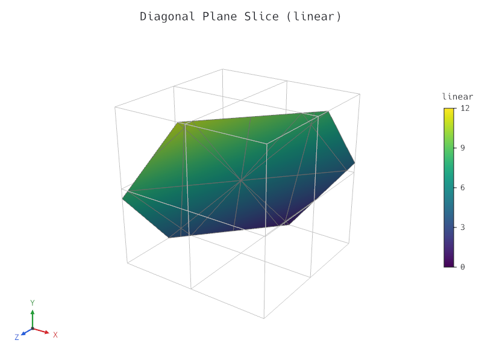
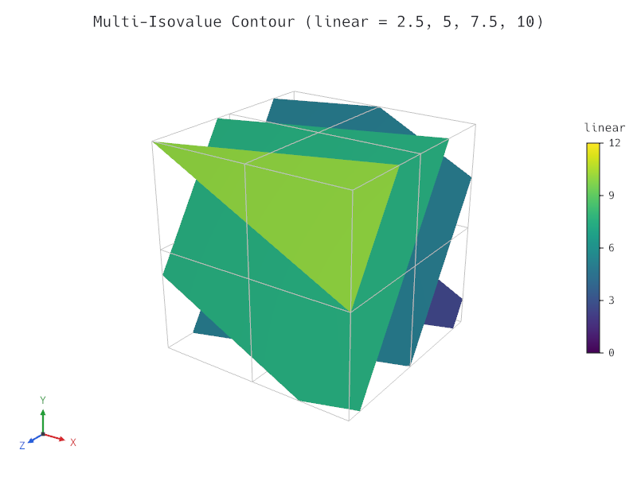
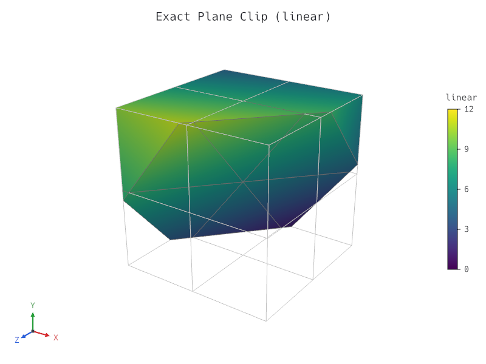
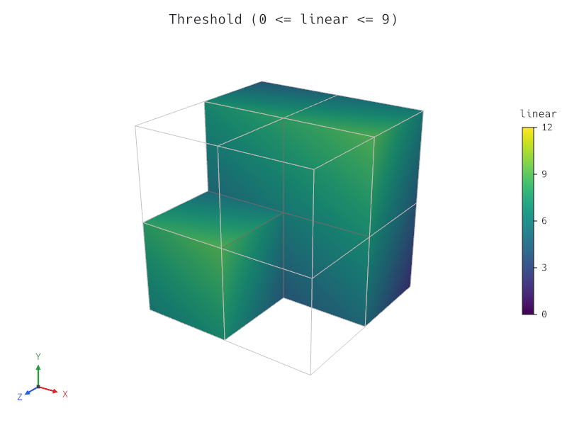

# Milestone M2 Gate — Core Filters & Release 0.1 Prep

- **Date:** 2026-10-24
- **Gate criteria (`docs/roadmap.md`):** *"release 0.1 on crates.io with docs and a gallery."*
- **Status:** Passed (all M2 tasks complete, verified, documented, and packaged at `0.1.0`; awaiting human approval before `cargo publish` and git tagging per `/milestone-gate`).

---

## 1. Checklist Verification

- All M2 tasks (`M2.1a` through `M2.10`) are ticked in `docs/roadmap.md`.
- Full verification suite (`cargo xtask verify`: `rustfmt`, `clippy --all-targets -- -D warnings`, workspace unit/integration/doc tests across all crates, `wasm32-unknown-unknown` build of `tetraglass-core`, `tetraglass-io`, `tetraglass-filters`, and `tetraglass-scene`, and `cargo-deny` check) passes cleanly.
- All 9 gallery scenes (`gallery/*.json`) validate, render, and match their committed visual regression baselines (`tests/baselines/*.png`) via `cargo test -p tetraglass-cli --test cli`.
- Workspace rustdoc (`cargo doc --workspace --no-deps`) builds with zero warnings and 19 passing doctests.
- User & developer mdBook guide (`docs/book/`) and `CHANGELOG.md` are complete.

---

## 2. Gate Demonstration

### 2.1 Core Filters Gallery (`slice`, `contour`, `clip`, `threshold`)

Command:

```sh
cargo test -p tetraglass-cli --test cli
```

Output:

```text
running 7 tests
test mdbook_guide_and_gallery_cover_all_filters_and_chapters_exist ... ok
test schema_command_matches_committed_snapshot ... ok
test view_command_supports_help_and_validates_scene_before_opening_window ... ok
test inspect_command_outputs_text_and_json ... ok
test validate_command_accepts_valid_scene_and_reports_suggestions_on_invalid_scene ... ok
test render_command_writes_png_and_prints_json_summary ... ok
test gallery_scenes_and_author_scene_skill_example_validate_and_match_baselines ... ok

test result: ok. 7 passed; 0 failed; 0 ignored; 0 measured; 0 filtered out
```

Rendered M2 filter gallery outputs (`800 × 600`, `4×` MSAA):

1. **Diagonal plane `slice` (`gallery/slice.json`):**
   

2. **Multi-isovalue `contour` (`gallery/contour.json`):**
   

3. **Exact half-space `clip` (`gallery/clip.json`):**
   

4. **Whole-cell scalar `threshold` (`gallery/threshold.json`):**
   

---

### 2.2 Performance Target Verification (`D-019`, `600,000` Tetrahedra / `100,000` Hexahedra)

Commands:

```sh
cargo bench -p tetraglass-filters --bench surface_bench
cargo bench -p tetraglass-render --bench render_bench
```

Measured `--release` results on the `50 × 50 × 40` synthetic mesh (`100,000` hexes / `600,000` tets, `106,641` points):

| Operation | Measured | Target (`D-019`) |
| --- | --- | --- |
| `linearize` (`100k` hexes -> `600k` tets) | `11.81 ms` | `<= 150.0 ms` |
| `extract_external_surface` (`100k` hexes -> `13,000` quads) | `16.91 ms` | `<= 150.0 ms` |
| `linearize` (`600k` tets) | `7.70 ms` | `<= 150.0 ms` |
| `extract_external_surface` (`600k` tets -> `26,000` tris) | `29.02 ms` | `<= 150.0 ms` |
| `slice` (`600k` tets, oblique plane -> `22,856` tris) | `5.32 ms` | `<= 50.0 ms` |
| `contour` (`600k` tets, single isovalue -> `42,568` tris) | `8.99 ms` | `<= 50.0 ms` |
| `clip (Exact)` + `extract_tet_view_surface` (`331,578` tets -> `36,228` tris) | `24.71 ms` | `<= 150.0 ms` |
| `clip (Crinkle)` + `extract_tet_view_surface` (`309,352` tets -> `20,470` tris) | `20.76 ms` | `<= 150.0 ms` |
| `threshold` + `extract_tet_view_surface` (`286,818` tets -> `21,548` tris) | `18.11 ms` | `<= 150.0 ms` |
| GPU orbit/pan/zoom + annotations (`1200×800`, `4x` MSAA) | `1.53 ms/frame` (`652.8 FPS`) | `<= 16.6 ms` (`60 FPS`) |
| GPU colormap/range uniform update (`1200×800`, `4x` MSAA) | `1.22 ms/frame` (`816.6 FPS`) | `<= 16.6 ms` (`60 FPS`) |
| GPU shader clip-plane drag update (`1200×800`, `4x` MSAA) | `0.88 ms/frame` (`1133.8 FPS`) | `<= 16.6 ms` (`60 FPS`) |

---

## 3. Release 0.1.0 Packaging Check

Command:

```sh
cargo package --no-verify --offline -p tetraglass-core -p tetraglass-io -p tetraglass-filters -p tetraglass-scene -p tetraglass-render -p tetraglass-egui -p tetraglass-viewer -p tetraglass-cli
```

Output:

```text
   Packaging tetraglass-core v0.1.0
    Packaged 14 files, 118.5KiB (26.5KiB compressed)
   Packaging tetraglass-io v0.1.0
    Packaged 15 files, 197.7KiB (35.9KiB compressed)
   Packaging tetraglass-filters v0.1.0
    Packaged 21 files, 290.1KiB (58.0KiB compressed)
   Packaging tetraglass-scene v0.1.0
    Packaged 13 files, 231.4KiB (47.5KiB compressed)
   Packaging tetraglass-render v0.1.0
    Packaged 22 files, 266.9KiB (62.5KiB compressed)
   Packaging tetraglass-egui v0.1.0
    Packaged 8 files, 129.8KiB (34.3KiB compressed)
   Packaging tetraglass-viewer v0.1.0
    Packaged 8 files, 193.5KiB (46.8KiB compressed)
   Packaging tetraglass-cli v0.1.0
    Packaged 8 files, 170.7KiB (40.1KiB compressed)
```
