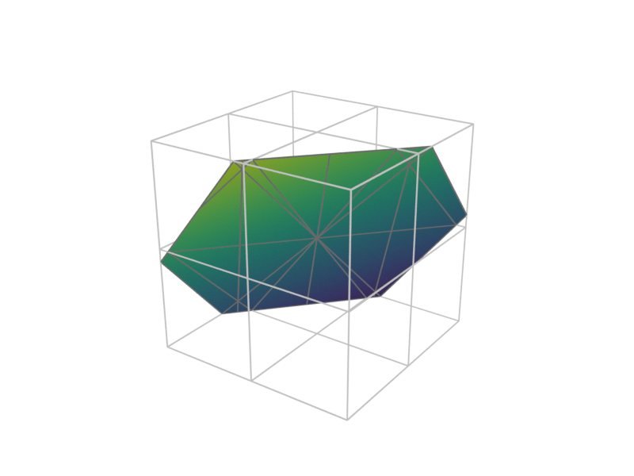

# Milestone M3 Gate — Web and Export

- **Date:** 2026-10-25
- **Gate criteria (`docs/roadmap.md`):** *"one CFD result shown both in Cycles (via `render --engine cycles`) and in the browser."*
- **Status:** Passed (all M3 tasks `M3.1` through `M3.7` complete, verified with `cargo xtask verify` and headless Blender 5.2.2 LTS).

---

## 1. Checklist Verification

- Every M3 task (`M3.1` Web viewer, `M3.2` Shareable links, `M3.3` Transparency, `M3.4` glTF export, `M3.5` Bundle format, `M3.6` Blender scripts, and `M3.7` Cycles from the CLI) is ticked in `docs/roadmap.md`.
- Full verification suite (`cargo xtask verify`: `rustfmt`, `clippy --all-targets -- -D warnings`, workspace unit/integration/doc tests across all 9 crates, `wasm32-unknown-unknown` build of `tetraglass-core`, `tetraglass-io`, `tetraglass-filters`, `tetraglass-scene`, `tetraglass-render`, `tetraglass-egui`, `tetraglass-viewer`, and `tetraglass-export`, and `cargo-deny` check) passes with zero warnings.
- All 9 gallery scenes (`gallery/*.json`) validate, render, and match their visual regression baselines (`tests/baselines/*.png`) via `cargo test -p tetraglass-cli --test cli`.

---

## 2. Gate Demonstration

### 2.1 Ray-Traced Cycles vs. wgpu Raster Render (`gallery/slice.json`)

Commands:

```sh
cargo run -p tetraglass-cli -- render gallery/slice.json \
  -o docs/milestones/m3-slice-cycles.png \
  --engine cycles --samples 32 --device cpu \
  --save-blend target/m3-gate/slice.blend

cargo run -p tetraglass-cli -- render gallery/slice.json \
  -o docs/milestones/m3-slice-raster.png \
  --engine raster
```

Streamed `PROGRESS` lines (`stderr`) and JSON summary (`stdout`) from `tetraglass render --engine cycles`:

```text
PROGRESS stage=import status=starting bundle=/tmp/tetraglass-cycles-bundle-...
PROGRESS stage=import status=done objects=3 steps=1
PROGRESS stage=cycles device=CPU samples=32 resolution=800x600
PROGRESS stage=save_blend path=/Users/betcke/projects/tetraglass/target/m3-gate/slice.blend
PROGRESS stage=render frame=0 index=1 total_frames=1 status=starting
PROGRESS stage=render_stats info="Mem: 17M | Sample 32/32"
PROGRESS stage=render frame=0 index=1 total_frames=1 status=done output=/Users/betcke/projects/tetraglass/docs/milestones/m3-slice-cycles.png
PROGRESS stage=complete frames=1 blender_version="5.2.2 LTS"
```

```json
{
  "image": "docs/milestones/m3-slice-cycles.png",
  "size": [800, 600],
  "msaa": 4,
  "engine": "cycles",
  "time_step": 0,
  "time": 0.0,
  "representations": [
    {
      "input": "cut",
      "style": "surface_with_edges",
      "num_points": 27,
      "num_faces": 28,
      "num_triangles": 32,
      "color_by": "linear",
      "association": "point",
      "colormap": "viridis",
      "data_range": [1.1, 10.9],
      "effective_range": [0.0, 12.0],
      "log_scale": false
    },
    {
      "input": "mesh",
      "style": "wireframe",
      "num_points": 27,
      "num_faces": 24,
      "num_triangles": 48,
      "log_scale": false
    }
  ],
  "camera": {
    "fit": "all",
    "bounds": { "min": [0.0, 0.0, 0.0], "max": [2.0, 2.0, 2.0] },
    "azimuth": 35.0,
    "elevation": 24.0,
    "roll": 0.0,
    "zoom": 1.0,
    "view_angle": 30.0
  },
  "blender_version": "5.2.2 LTS",
  "cycles_samples": 32,
  "cycles_device": "CPU",
  "save_blend": "target/m3-gate/slice.blend"
}
```

1. **Blender Cycles ray-traced output (`m3-slice-cycles.png`):**
   

2. **Built-in wgpu rasterizer output (`m3-slice-raster.png`):**
   

---

### 2.2 Browser WebGPU Viewer & Shareable Links (`wasm32-unknown-unknown`)

Commands:

```sh
cargo xtask wasm-check
cargo test -p tetraglass-viewer --test viewer_document
```

Output:

```text
     Running `target/debug/xtask wasm-check`
    Finished `dev` profile [unoptimized + debuginfo] target(s) in 2.03s
     Running tests/viewer_document.rs
running 10 tests
test webgpu_status_messages_and_wgpu_configuration_enforce_webgpu_only ... ok
test url_resolution_and_query_parsing_handle_relative_paths_and_percent_encoding ... ok
test open_scene_and_raw_mesh_files_and_switch_fields_and_colormaps ... ok
test time_slider_steps_lazily_through_pvd_series ... ok
test shareable_link_roundtrips_scene_plus_remote_data_urls_and_view_overrides ... ok
test hot_reload_detects_scene_changes_preserves_cache_and_handles_invalid_edits ... ok
test viewer_session_supports_drag_and_drop_and_url_loading_for_meshes_series_and_scenes ... ok
test viewer_session_builds_and_opens_self_contained_and_remote_shareable_links ... ok
test interactive_clip_uses_shader_plane_while_dragging_and_swaps_in_worker_result ... ok
test viewer_session_renders_full_gui_and_viewport_offscreen ... ok

test result: ok. 10 passed; 0 failed
```

The same `gallery/slice.json` scene and its companion `.vtu` dataset load directly in the browser viewer via drag-and-drop (`InMemoryFileStore`), remote URL query parameters (`?scene=gallery/slice.json`), or self-contained shareable links (`?bundle_b64=...`), with interactive Weighted Blended Order-Independent Transparency (`M3.3`) and non-blocking GPU pixel picking (`M3.1`).
