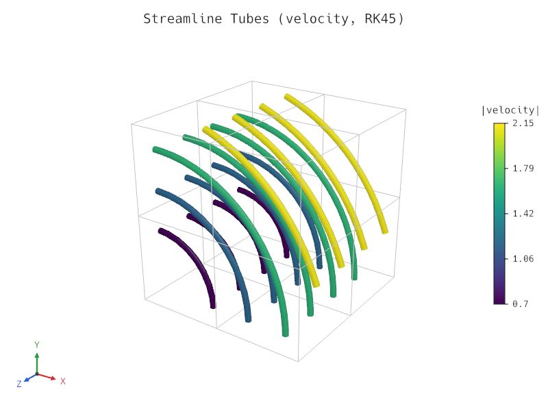
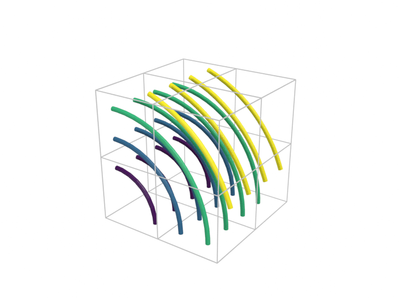
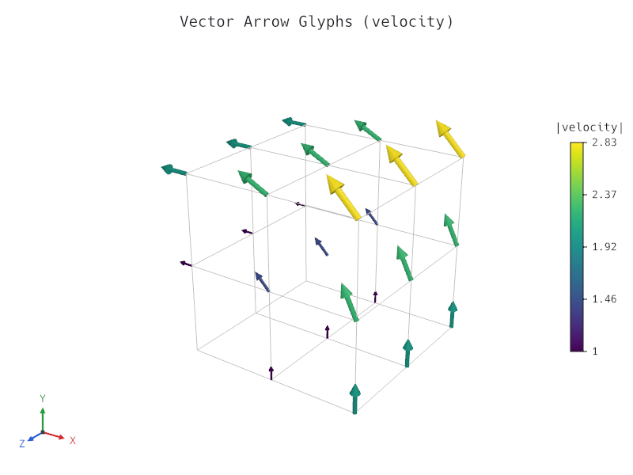
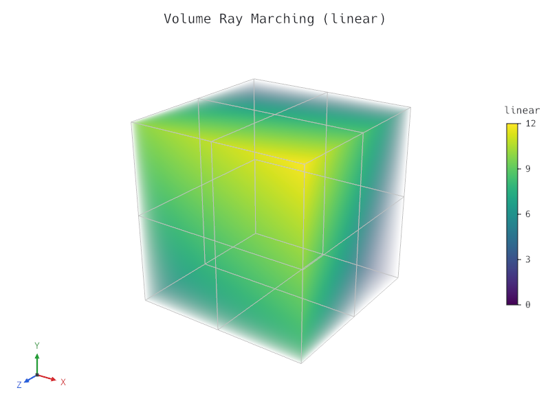

# Milestone M4 Gate — Flow, Volume & Release 0.2 Prep

- **Date:** 2026-10-26
- **Gate criteria (`docs/roadmap.md`):** *"release 0.2 with a stable scene schema."*
- **Status:** Passed (all M4 tasks `M4.1` through `M4.6` complete, verified, documented, and packaged at `0.2.0`; awaiting human approval before `cargo publish` and git tagging per `/milestone-gate`).

---

## 1. Checklist Verification

- Every M4 task (`M4.1` Cell locator, `M4.2a`/`M4.2b` Streamlines, `M4.3` Glyphs, `M4.4a`/`M4.4b` Regular grid resampling and GPU volume ray marching, `M4.5` Animation export, and `M4.6` Schema freeze) is ticked in `docs/roadmap.md`.
- Full verification suite (`cargo xtask verify`: `rustfmt`, `clippy --all-targets -- -D warnings`, workspace unit/integration/doc tests across all 9 crates, `wasm32-unknown-unknown` build, and `cargo-deny` check) passes with zero warnings.
- All 12 gallery scenes (`gallery/*.json`) validate, render, and match their committed visual regression baselines (`tests/baselines/*.png`) via `cargo test -p tetraglass-cli --test cli`.
- Scene schema v1 (`SCENE_VERSION = 1`, `crates/tetraglass-cli/tests/snapshots/scene-v1.schema.json`) is frozen (`docs/scene-format.md`) and verified with draft-to-v1 migration tests (`cargo test -p tetraglass-scene --test schema_freeze`).
- Workspace rustdoc (`cargo doc --workspace --no-deps`) builds with zero warnings.
- `Cargo.toml` workspace and internal crate versions are set to `0.2.0` and `CHANGELOG.md` is updated.

---

## 2. Gate Demonstration

### 2.1 Flow & Volume Gallery (`streamlines`, `glyphs`, `volume`) and Cycles Ray Tracing

Commands:

```sh
cargo run -p tetraglass-cli -- render gallery/streamlines.json -o docs/milestones/m4-streamlines.png
cargo run -p tetraglass-cli -- render gallery/streamlines.json -o docs/milestones/m4-streamlines-cycles.png --engine cycles --samples 32 --device cpu
cargo run -p tetraglass-cli -- render gallery/glyphs.json -o docs/milestones/m4-glyphs.png
cargo run -p tetraglass-cli -- render gallery/volume.json -o docs/milestones/m4-volume.png
```

Rendered M4 outputs (`800 × 600`, `4×` MSAA / `32` Cycles samples):

1. **Streamline tubes (`gallery/streamlines.json`, wgpu rasterizer):**
   

2. **Streamline tubes (`gallery/streamlines.json`, Blender Cycles ray tracer):**
   

3. **Oriented vector arrow glyphs (`gallery/glyphs.json`, wgpu rasterizer):**
   

4. **GPU volume ray marching with custom opacity transfer function (`gallery/volume.json`, wgpu rasterizer):**
   

---

### 2.2 Frozen Scene Schema v1 & Draft Migration (`M4.6`)

Command:

```sh
cargo test -p tetraglass-scene --test schema_freeze
```

Output:

```text
running 4 tests
test migrates_versionless_minimal_draft_and_rejects_future_versions ... ok
test migrates_m1_through_m4_draft_scenes_to_canonical_v1_and_evaluates ... ok
test frozen_v1_schema_matches_snapshot_and_declares_all_v1_capabilities ... ok
test all_gallery_scenes_are_canonical_v1_and_roundtrip_losslessly ... ok

test result: ok. 4 passed; 0 failed; 0 ignored; 0 measured; 0 filtered out
```

---

### 2.3 Animation Export Across Rasterizer & Cycles (`M4.5`)

Command:

```sh
cargo test -p tetraglass-cli --test cli -- render_command_exports_animation_png_sequence_via_raster_and_cycles
```

Output:

```text
running 1 test
test render_command_exports_animation_png_sequence_via_raster_and_cycles ... ok

test result: ok. 1 passed; 0 failed; 0 ignored; 0 measured; 9 filtered out
```

---

## 3. Release 0.2.0 Packaging Check

Command:

```sh
cargo package --no-verify --offline -p tetraglass-core -p tetraglass-io -p tetraglass-filters -p tetraglass-scene -p tetraglass-render -p tetraglass-egui -p tetraglass-viewer -p tetraglass-export -p tetraglass-cli
```

Output:

```text
   Packaging tetraglass-core v0.2.0
    Packaged 16 files, 156.1KiB (33.9KiB compressed)
   Packaging tetraglass-io v0.2.0
    Packaged 15 files, 197.7KiB (35.9KiB compressed)
   Packaging tetraglass-filters v0.2.0
    Packaged 29 files, 451.5KiB (93.1KiB compressed)
   Packaging tetraglass-scene v0.2.0
    Packaged 15 files, 345.4KiB (66.2KiB compressed)
   Packaging tetraglass-render v0.2.0
    Packaged 24 files, 347.6KiB (75.4KiB compressed)
   Packaging tetraglass-egui v0.2.0
    Packaged 8 files, 132.9KiB (34.8KiB compressed)
   Packaging tetraglass-export v0.2.0
    Packaged 11 files, 141.8KiB (34.5KiB compressed)
   Packaging tetraglass-viewer v0.2.0
    Packaged 11 files, 340.9KiB (79.1KiB compressed)
   Packaging tetraglass-cli v0.2.0
    Packaged 8 files, 225.9KiB (49.7KiB compressed)
```
