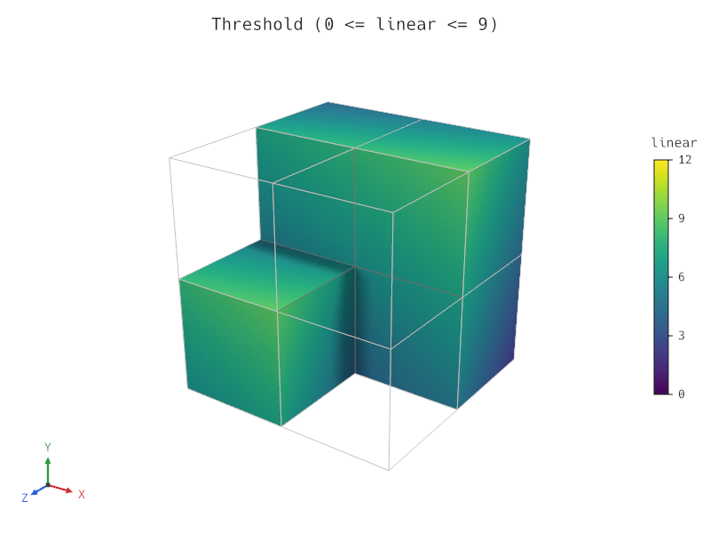
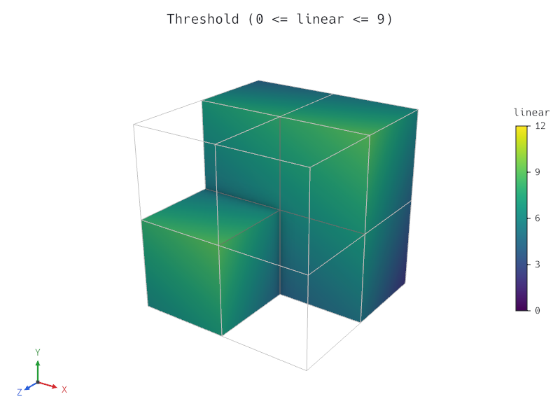
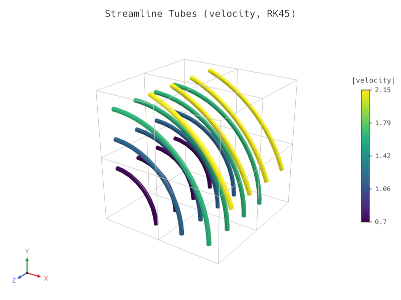

# Milestone M5 Gate — Path Tracer, SSAO, Legacy VTK & Persistent Blender Worker

- **Date:** 2026-10-26
- **Gate criteria (`docs/roadmap.md`):** *"a scene renders with the built-in compute-shader progressive path tracer, SSAO, and legacy `.vtk` input across the CLI and viewer."*
- **Status:** Passed (all M5 tasks `M5.1` through `M5.5` complete, verified, and documented).

---

## 1. Checklist Verification

- Every M5 task (`M5.1` Legacy VTK `.vtk` reader, `M5.2` Screen-space ambient occlusion, `M5.3a` GPU triangle BVH and compute-shader progressive path tracer, `M5.3b` Progressive path tracer in the viewer and CLI, and `M5.4` Persistent Blender worker and live link) is ticked in `docs/roadmap.md`.
- Full verification suite (`cargo xtask verify`: `rustfmt`, `clippy --all-targets -- -D warnings`, workspace unit/integration/doc tests across all 9 crates, `wasm32-unknown-unknown` build, and `cargo-deny` check) passes with zero warnings.
- All 12 gallery scenes (`gallery/*.json`) validate, render, and match their committed visual regression baselines (`tests/baselines/*.png`) via `cargo test -p tetraglass-cli --test cli`.
- Workspace rustdoc (`cargo doc --workspace --no-deps`) builds with zero warnings.

---

## 2. Gate Demonstration

### 2.1 Built-in Compute-Shader Progressive Path Tracer & SSAO (`M5.2`, `M5.3a`, `M5.3b`)

Commands:

```sh
cargo run -p tetraglass-cli -- render gallery/threshold.json -o docs/milestones/m5-threshold-pathtracer.png --engine path-tracer --samples 64
cargo run -p tetraglass-cli -- render gallery/threshold.json -o docs/milestones/m5-threshold-ssao.png --ssao
cargo run -p tetraglass-cli -- render gallery/streamlines.json -o docs/milestones/m5-streamlines-pathtracer.png --engine path-tracer --samples 64
```

Rendered M5 outputs (`800 × 600`, `64` path-tracing samples / `4×` MSAA + SSAO):

1. **Thresholded hexahedral mesh (`gallery/threshold.json`, compute-shader progressive path tracer, 64 spp):**
   

2. **Thresholded hexahedral mesh (`gallery/threshold.json`, wgpu rasterizer with SSAO):**
   

3. **Streamline tubes (`gallery/streamlines.json`, compute-shader progressive path tracer, 64 spp):**
   

---

### 2.2 Legacy VTK (`.vtk`) Reader Across CLI & Viewer (`M5.1`)

Command:

```sh
cargo test -p tetraglass-io --test vtk_legacy && cargo test -p tetraglass-cli --test cli -- inspect_validate_and_render_legacy_vtk_files
```

Output:

```text
running 5 tests
test vtk_legacy_rejects_corrupted_truncated_or_non_unstructured_inputs ... ok
test vtk_legacy_supports_vectors_normals_tensors_field_tables_metadata_and_pvd ... ok
test vtk_legacy_supports_all_cell_families_higher_order_node_ordering_and_polyhedra ... ok
test vtk_legacy_v42_and_v51_ascii_and_binary_match_vtu_and_roundtrip ... ok
test committed_legacy_vtk_testdata_files_parse_and_match ... ok

test result: ok. 5 passed; 0 failed; 0 ignored; 0 measured; 0 filtered out

running 1 test
test inspect_validate_and_render_legacy_vtk_files ... ok

test result: ok. 1 passed; 0 failed; 0 ignored; 0 measured; 11 filtered out
```

---

### 2.3 Persistent Blender Worker & Live Camera Link (`M5.4`)

Command:

```sh
cargo test -p tetraglass-export --test bundle_export
```

Output:

```text
running 5 tests
test tgbin_decoder_rejects_corrupted_headers_and_out_of_bounds_indices ... ok
test multi_step_series_bundle_exports_all_steps_and_round_trips ... ok
test blender_worker_client_protocol_round_trips_and_propagates_errors ... ok
test gallery_scenes_round_trip_through_bundle_writer_and_reader ... ok
test blender_scripts_spdx_headers_addon_registration_and_headless_cycles_render ... ok

test result: ok. 5 passed; 0 failed; 0 ignored; 0 measured; 0 filtered out
```
