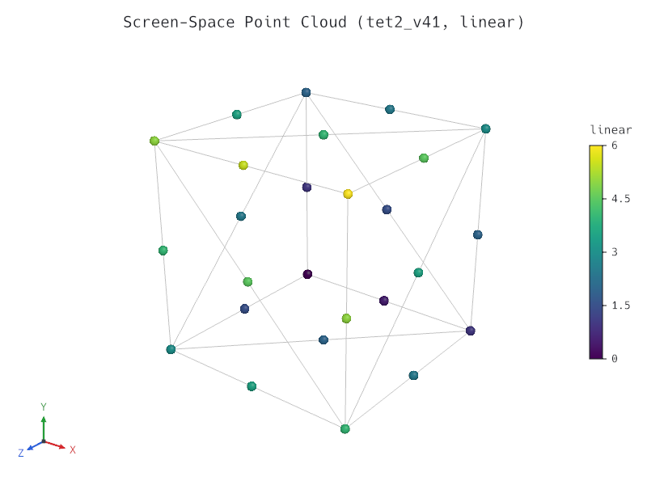

# Milestone M6 Gate — Ergonomics, Parallel I/O, Array Filters & Release 0.3 Prep

- **Date:** 2026-10-26
- **Gate criteria (`docs/roadmap.md`):** *"release 0.3 with the `tetraglass` umbrella crate and fluent Rust `SceneBuilder` API, `"points"` representation rendering, `.pvtu` partitioned VTK reader, and `warp_by_vector` / `calculator` filters."*
- **Status:** Passed (all M6 tasks `M6.1` through `M6.5` complete, verified, documented, and packaged at `0.3.0`; awaiting human approval before `cargo publish` and git tagging per `/milestone-gate`).

---

## 1. Checklist Verification

- Every M6 task (`M6.1` Umbrella `tetraglass` crate and fluent Rust `SceneBuilder` API, `M6.2` Screen-space `"points"` representation rendering, `M6.3` Parallel VTK XML `.pvtu` partitioned unstructured grid reader, and `M6.4` `warp_by_vector` and `calculator` array filters) is ticked in `docs/roadmap.md`.
- Full verification suite (`cargo xtask verify`: `rustfmt`, `clippy --all-targets -- -D warnings`, workspace unit/integration/doc tests across all 10 crates, `wasm32-unknown-unknown` build including `tetraglass`, and `cargo-deny` check) passes with zero warnings.
- All 13 gallery scenes (`gallery/*.json`, including `gallery/points.json`) validate, render, and match their committed visual regression baselines (`tests/baselines/*.png`) via `cargo test -p tetraglass-cli --test cli`.
- Scene schema v1 (`SCENE_VERSION = 1`, `crates/tetraglass-cli/tests/snapshots/scene-v1.schema.json`) remains 100% frozen and backwards-compatible (`cargo test -p tetraglass-scene --test schema_freeze`).
- Workspace rustdoc (`cargo doc --workspace --no-deps`) builds with zero warnings.
- `Cargo.toml` workspace and internal crate versions are set to `0.3.0` and `CHANGELOG.md` is updated.

---

## 2. Gate Demonstration

### 2.1 Screen-Space `"points"` Representation Rendering (`M6.2`)

Command:

```sh
cargo run -p tetraglass-cli -- render gallery/points.json -o docs/milestones/m6-points.png
```

Rendered M6 output (`800 × 600`, `4×` MSAA):

1. **Screen-space sphere-impostor point cloud (`gallery/points.json`, wgpu rasterizer):**
   

---

### 2.2 Umbrella `tetraglass` Crate, Fluent `SceneBuilder`, `.pvtu` Reader & `warp_by_vector` / `calculator` Pipeline (`M6.1`, `M6.3`, `M6.4`)

Commands:

```sh
cargo test -p tetraglass --test umbrella_pipeline
cargo test -p tetraglass-io --test pvtu
cargo test -p tetraglass-filters --test warp_and_calculator
```

Output:

```text
running 2 tests
test umbrella_crate_reads_partitioned_pvtu_and_extracts_seamless_surface ... ok
test umbrella_crate_builds_validates_evaluates_exports_and_renders_scene ... ok

test result: ok. 2 passed; 0 failed; 0 ignored; 0 measured; 0 filtered out

running 5 tests
test detects_pvtu_format_from_extension_and_magic_bytes ... ok
test parses_pvtu_manifest_metadata_and_pieces ... ok
test rejects_truncated_and_malformed_pvtu_manifests_without_panicking ... ok
test merges_polyhedron_pieces_and_preserves_discontinuous_interface_nodes ... ok
test reads_partitioned_pvtu_filters_ghost_cells_welds_interface_and_matches_single_vtu ... ok

test result: ok. 5 passed; 0 failed; 0 ignored; 0 measured; 0 filtered out

running 5 tests
test warp_by_vector_analytic_dilation_and_shear_on_hex_linear ... ok
test calculator_evaluates_scalars_vectors_tensors_and_cell_expressions ... ok
test warp_and_calculator_validate_parameters_and_expressions ... ok
test warp_and_calculator_are_deterministic_across_chunk_sizes_and_handle_empty_views ... ok
test warp_and_calculator_work_across_all_testdata_cell_families_and_chain_into_slice_and_contour ... ok

test result: ok. 5 passed; 0 failed; 0 ignored; 0 measured; 0 filtered out
```

---

## 3. Release 0.3.0 Packaging Check

Command:

```sh
cargo package --no-verify --offline -p tetraglass-core -p tetraglass-io -p tetraglass-filters -p tetraglass-scene -p tetraglass-render -p tetraglass-egui -p tetraglass-export -p tetraglass-viewer -p tetraglass -p tetraglass-cli
```

Output:

```text
   Packaging tetraglass-core v0.3.0
    Packaged 16 files, 156.6KiB (34.1KiB compressed)
   Packaging tetraglass-io v0.3.0
    Packaged 19 files, 324.2KiB (58.7KiB compressed)
   Packaging tetraglass-filters v0.3.0
    Packaged 32 files, 530.0KiB (107.2KiB compressed)
   Packaging tetraglass-scene v0.3.0
    Packaged 16 files, 385.5KiB (75.1KiB compressed)
   Packaging tetraglass-render v0.3.0
    Packaged 27 files, 510.9KiB (105.2KiB compressed)
   Packaging tetraglass-egui v0.3.0
    Packaged 8 files, 141.4KiB (36.5KiB compressed)
   Packaging tetraglass-export v0.3.0
    Packaged 12 files, 172.6KiB (41.7KiB compressed)
   Packaging tetraglass-viewer v0.3.0
    Packaged 11 files, 372.8KiB (84.5KiB compressed)
   Packaging tetraglass v0.3.0
    Packaged 7 files, 96.3KiB (26.4KiB compressed)
   Packaging tetraglass-cli v0.3.0
    Packaged 8 files, 240.2KiB (52.3KiB compressed)
```
